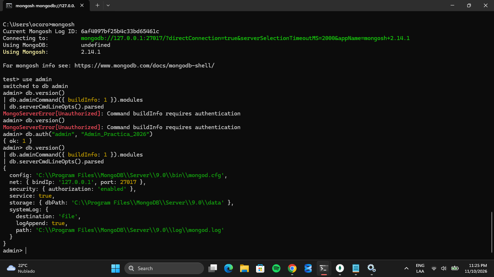

# 01 - Edición y Limitaciones de Auditoría

## 1. ¿Qué edición de MongoDB estás usando? ¿Qué evidencia lo demuestra?
Estoy utilizando **MongoDB Community Edition** (versión 9.0). 
La evidencia es el resultado del comando `db.adminCommand({ buildInfo: 1 }).modules`, el cual devuelve un arreglo vacío `[]`. Si estuviera ejecutando la edición Enterprise, este arreglo contendría el valor `["enterprise"]`.

## 2. ¿A dónde escribe tu servidor su bitácora? ¿Cómo lo sabes?
El servidor escribe su bitácora en un archivo físico ubicado en `C:\Program Files\MongoDB\Server\9.0\log\mongod.log`. 
Lo sé porque al ejecutar `db.serverCmdLineOpts().parsed` se observa la configuración activa del proceso, la cual incluye el parámetro `systemLog` con `destination: "file"` y el `path` apuntando a esa ruta exacta.

## 3. Según REF-U3-04, ¿qué cuatro categorías de eventos registraría la auditoría nativa?
Si contáramos con la auditoría nativa disponible en MongoDB Enterprise o Atlas, las cuatro categorías de eventos registrados serían:
1. **Cambios de esquema (DDL).**
2. **Eventos de conjuntos de réplicas y clústeres fragmentados.**
3. **Autenticación y autorización.**
4. **Operaciones CRUD** (requiere configurar `auditAuthorizationSuccess: true`).

## 4. ¿Qué tendría que evaluar una organización antes de licenciar Enterprise o migrar a Atlas solo para obtener auditoría?
La organización debe realizar un análisis costo-beneficio analizando los siguientes puntos:
* **Cumplimiento normativo:** Determinar si regulaciones externas (como PCI-DSS, HIPAA o GDPR) exigen explícitamente auditoría nativa e inmutable.
* **Costo financiero:** Evaluar el incremento en licenciamiento de Enterprise Edition o el costo de escalar a clústeres M10+ en Atlas frente al impacto de un eventual incidente de seguridad.
* **Suficiencia de controles compensatorios:** Evaluar si los mecanismos nativos de Community Edition (Perfilador `system.profile`, bitácora JSON de `mongod` y respaldos de privilegios) junto con herramientas externas de monitoreo son suficientes para mitigar los riesgos operativos de la empresa.

