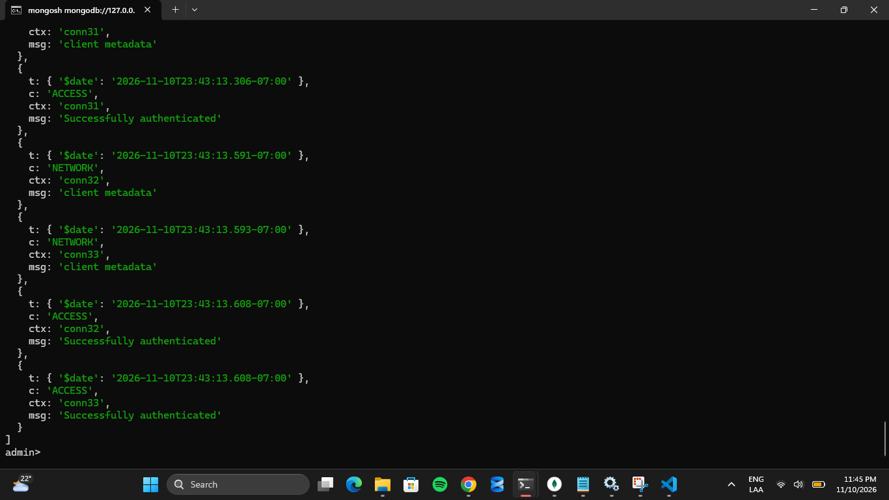

# 02 - El Incidente sin Perfilado

## 1. ¿Puedes demostrar qué cambió? ¿Y quién se conectó a esa hora?
* **Demostración del cambio:** **No hay evidencia con esta edición** para demostrar la sentencia de cambio ejecutada, el valor anterior del RFC o el momento exacto de la modificación. Al estar el perfilador en nivel 0 (`was: 0`), las operaciones de lectura y escritura (CRUD) no quedan registradas en ningún lado dentro de Community Edition. Solo es posible consultar el estado actual del documento (`rfc: "GAMA780912XXX"`), pero no la trazabilidad de la operación.
* **Demostración de la conexión:** Sí se puede demostrar mediante la bitácora (`mongod.log` / `getLog`) que el usuario `app_ventas` con la aplicación `app-ventas-web` se conectó y se autenticó exitosamente a una hora determinada (`msg: "Successfully authenticated"`). Sin embargo, la bitácora registra únicamente el evento de conexión/autenticación (`ACCESS`), no las consultas ejecutadas durante la sesión.

## 2. ¿Por qué mongosh abre varias conexiones (conn8, conn9, …) para una sola instrucción? ¿Cuál es la que se autentica?
* **Razones de múltiples conexiones:** Al ejecutar una instrucción con `mongosh`, el cliente primero abre una conexión inicial (por ejemplo, `conn8`) para la negociación del protocolo de alambre (*wire protocol*) y el envío de metadatos del cliente (`client metadata`). Esta primera conexión figura como `Connection not authenticating`.
* **Conexión autenticada:** Posteriormente, el cliente establece una conexión principal (por ejemplo, `conn9`) sobre la cual envía los mecanismos de autenticación (SASL/SCRAM) con las credenciales del usuario. La conexión que efectivamente se autentica es la que genera el mensaje en el componente `ACCESS` indicando `Successfully authenticated`.

