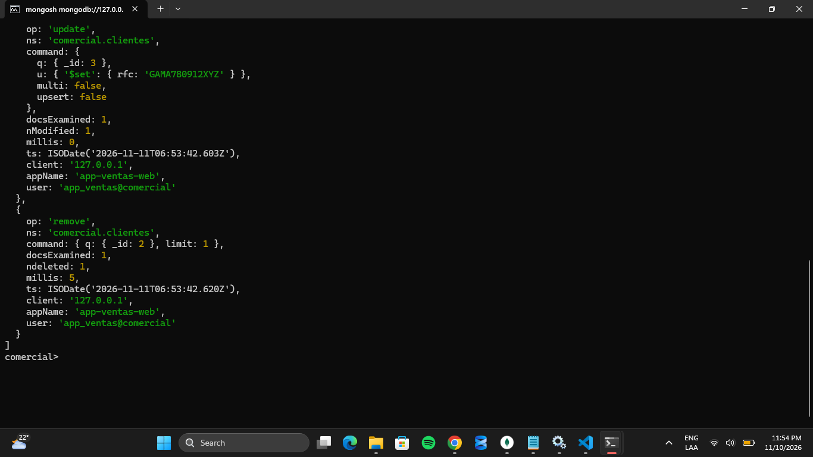

# 03 - Activar el Perfilador y Registrar Operaciones

## 9.1 Tabla de Interpretación de Documentos

| # | op | Usuario | Cliente | Aplicación | Momento | Qué hizo | Documentos afectados |
|---|---|---|---|---|---|---|---|
| 1 | query | `app_ventas@comercial` | 127.0.0.1 | app-ventas-web | 2026-10-25T22:52:45.906Z | Consulta de clientes de Culiacán proyectando nombre y ciudad | 5 examinados / 3 devueltos |
| 2 | update | `app_ventas@comercial` | 127.0.0.1 | app-ventas-web | 2026-10-25T22:52:45.909Z | Actualización del RFC a `GAMA780912XYZ` para el `_id: 3` | 1 examinado / 1 modificado |
| 3 | remove | `app_ventas@comercial` | 127.0.0.1 | app-ventas-web | 2026-10-25T22:52:45.915Z | Eliminación del registro con `_id: 2` | 1 examinado / 1 eliminado |

## Preguntas

### 1. ¿Puedes saber cuál era el RFC antes del cambio con la información de system.profile?
No. El perfilador registra únicamente la instrucción de actualización enviada (`$set: { rfc: "GAMA780912XYZ" }`), pero no almacena el estado ni los valores previos que contenía el documento antes de aplicar el cambio.

### 2. ¿Puedes saber qué datos tenía el documento eliminado?
No. La entrada del perfilador solo especifica que se ejecutó un comando `remove` filtrado por `{ _id: 2 }` y que se eliminó 1 documento (`ndeleted: 1`). Los valores de los demás campos que componían a ese cliente se pierden sin posibilidad de ser recuperados a través del perfilador.

### 3. A diferencia de log_statement = 'mod' en PostgreSQL, el nivel 2 sí registró la consulta. ¿Qué ventaja y qué riesgo tiene eso?
* **Ventaja:** Proporciona visibilidad total sobre la lectura de datos, permitiendo auditar accesos no autorizados, detectar exfiltración de información sensible o identificar consultas ineficientes enviadas por las aplicaciones.
* **Riesgo:** Genera una degradación de rendimiento severa debido a la sobrecarga de I/O por registrar cada lectura en disco, sumado al crecimiento desmedido de la colección `system.profile` que consume memoria y almacenamiento aceleradamente.

### 4. ¿Por qué el campo user incluye @comercial?
Porque en MongoDB los usuarios están definidos dentro de una base de datos específica (base de datos de autenticación). La sintaxis `app_ventas@comercial` indica que la cuenta `app_ventas` se autenticó y pertenece a la base de datos `comercial`.

