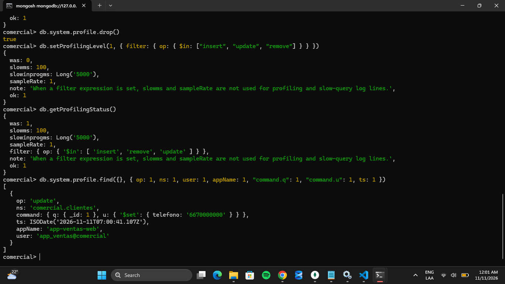

# 04 - Reducir el Volumen con un Filtro

## Preguntas

### 1. ¿Qué perdiste de evidencia al aplicar el filtro? ¿Qué ganaste?
* **Lo que se perdió:** Se perdió la trazabilidad sobre todas las operaciones de lectura (consultas como `find` o `aggregate`). Si un usuario o aplicación consulta datos sensibles, la operación ya no quedará registrada en el perfilador.
* **Lo que se ganó:** Se optimizó significativamente el rendimiento y consumo de almacenamiento del servidor. Al ignorar las lecturas y capturar solo las operaciones que alteran datos (`insert`, `update`, `remove`), se reduce drásticamente la sobrecarga de escritura en disco y el volumen de crecimiento de `system.profile`.

### 2. ¿Qué filtro usarías si solo interesaran operaciones sobre la colección clientes?
Para filtrar únicamente las operaciones sobre la colección `clientes` de la base de datos `comercial`, se utiliza el campo de namespace (`ns`):



```javascript
db.setProfilingLevel(1, { filter: { ns: "comercial.clientes" } })

