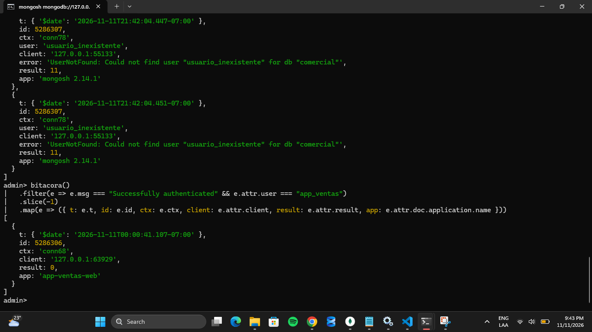

# 05 - Accesos en la Bitácora de mongod

## Preguntas

### 1. ¿Qué campo distingue un acceso fallido de uno exitoso?
* **Campo principal (`msg` y `id`):** En los intentos fallidos el campo `msg` toma el valor `"Failed to authenticate"` (identificador de evento `5286307`), mientras que en los accesos válidos registra `"Successfully authenticated"` (identificador `5286306`).
* **Campos complementarios (`attr.result` y `attr.error`):** En un acceso exitoso, `attr.result` es `0` y no existe campo de error. En un acceso fallido, `attr.result` devuelve un código numérico distinto de cero (por ejemplo, `18` o `11`) y se incluye el campo `attr.error` con el motivo técnico del rechazo.

### 2. ¿Qué diferencia hay entre el error de contraseña incorrecta y el de usuario inexistente? ¿Por qué el cliente recibe el mismo mensaje en ambos casos?
* **Diferencia en la bitácora del servidor:**
  * **Contraseña incorrecta:** Registra `AuthenticationFailed: SCRAM authentication failed, storedKey mismatch` con código `result: 18`, indicando que la cuenta existe pero el hash criptográfico de la contraseña no coincide.
  * **Usuario inexistente:** Registra `UserNotFound: Could not find user "usuario_inexistente" for db "comercial"` con código `result: 11`, indicando que el usuario no está dado de alta en esa base de datos.
* **Motivo del mensaje genérico al cliente:** MongoDB devuelve siempre `MongoServerError: Authentication failed.` para evitar la **enumeración de usuarios**. Si revelara qué usuario existe y cuál no, un atacante podría descubrir cuentas válidas del sistema antes de lanzar ataques de fuerza bruta sobre las contraseñas.

### 3. ¿Por qué el nombre de la aplicación del intento fallido es mongosh 2.10.0 y no app-ventas-web?
Porque en las cadenas de conexión (URI) usadas para los intentos fallidos se omitió el parámetro `?appName=app-ventas-web`. Cuando no se especifica un `appName` personalizado, el controlador envía automáticamente como metadato el nombre y la versión del cliente que ejecutó la conexión (en este caso, la versión instalada de `mongosh`).

