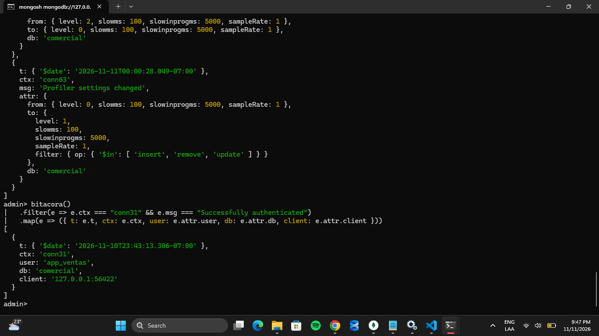

# 06 - Correlacionar un Cambio de Configuración con su Autor

## Preguntas

### 1. ¿Qué usuario cambió la configuración del perfilador? ¿Qué dos eventos lo demuestran?
* **Usuario responsable:** El usuario `admin` (autenticado en la base de datos `admin`).
* **Eventos que lo demuestran:**
  1. **Evento de autenticación (`Successfully authenticated`):** Registra que el usuario `admin` inició sesión exitosamente desde el cliente local (`127.0.0.1`) bajo un identificador de contexto de conexión específico (por ejemplo, `ctx: "conn31"`).
  2. **Evento de cambio de configuración (`Profiler settings changed`):** Ocurre posteriormente dentro del **mismo contexto de conexión (`ctx`)**, dejando constancia de la modificación de nivel y filtro del perfilador (`from` -> `to`) sobre la base de datos `comercial`.

### 2. ¿Qué condición debe cumplirse para que esta correlación sea válida?
* **Continuidad del proceso `mongod` y de la sesión:** Ambos eventos deben encontrarse dentro del **mismo ciclo de ejecución ininterrumpido del servidor** (sin reinicios de `mongod` entre ambos registros, ya que al reiniciar el servicio los identificadores `conn1`, `conn2`, etc., vuelven a numerarse desde cero).
* **Secuencia temporal y vigencia de la conexión:** La marca de tiempo (`t`) de `Successfully authenticated` debe ser anterior a la de `Profiler settings changed`, y no debe existir un evento de cierre (`End connection`) ni una reautenticación con otro usuario para ese mismo `ctx` en el intervalo entre ambos eventos.

### 3. ¿Por qué es relevante que quede registrado un cambio de configuración del propio mecanismo de registro?
* **Integridad de la auditoría y detección de evasión:** En seguridad informática, una técnica común tras comprometer una cuenta con privilegios administrativos es desactivar o alterar los registros de auditoría para borrar huellas o ejecutar acciones maliciosas sin ser detectado. Que `mongod` registre automáticamente cualquier alteración sobre el perfilador en su bitácora permite detectar intentos de manipulación, identificar al responsable y delimitar la ventana exacta de tiempo en la que el sistema quedó sin visibilidad de trazabilidad.

