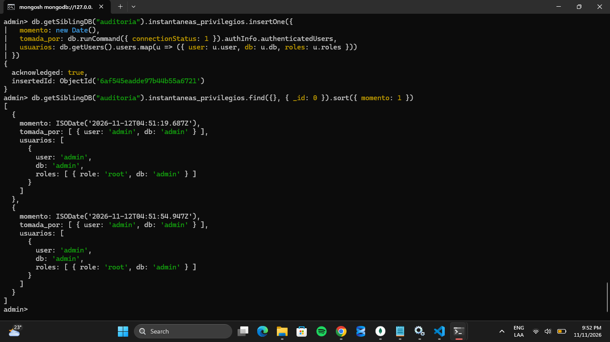

# 07 - Cambios de Privilegios: El Límite Más Importante

## Análisis del Control Compensatorio

| Pregunta | ¿La instantánea responde? | Detalle |
|---|---|---|
| ¿Cambiaron los privilegios de `app_ventas`? | Sí | Se detecta una diferencia en el arreglo `roles` entre ambas capturas. |
| ¿Qué rol se agregó? | Sí | Se identifica la adición del rol `dbAdmin` sobre la base `comercial`. |
| ¿Quién lo agregó? | No | Solo registra qué cuenta ejecutó la instantánea (`tomada_por`), no el autor del `grantRolesToUser`. |
| ¿Cuándo exactamente? | No | Únicamente acota que el cambio ocurrió en el intervalo entre la primera y la segunda instantánea. |

## Preguntas

### 1. ¿Por qué un cambio de privilegios es uno de los eventos auditables más importantes?
Porque la elevación o modificación de privilegios rompe el principio de menor privilegio y permite a un usuario o atacante obtener acceso no autorizado a datos confidenciales, alterar esquemas, modificar configuraciones del servidor o desactivar los propios mecanismos de registro para encubrir otras acciones maliciosas.

### 2. ¿Con qué frecuencia tomarías instantáneas? ¿Qué factores influyen?
* **Frecuencia recomendada:** En entornos productivos críticos sin auditoría nativa, cada **15 a 60 minutos** mediante una tarea automatizada con comparación automática de diferencias (alertas ante cambios); en sistemas con baja rotación operativa, al menos una vez al día.
* **Factores que influyen:** La criticidad y sensibilidad de los datos almacenados, los requisitos normativos o de cumplimiento (ISO 27001, PCI-DSS, LFPDPPP), la frecuencia habitual de cambios administrativos en la organización y la ventana máxima de exposición tolerable ante un incidente.

### 3. ¿Quién debería poder escribir en `auditoria.instantaneas_privilegios`?
Únicamente una **cuenta de servicio automatizada dedicada** al proceso de monitoreo, con permisos estrictamente limitados a inserción (`insert`) sobre esa colección, sin permisos de actualización (`update`) ni eliminación (`delete`) para garantizar la inmutabilidad de las instantáneas. Las cuentas de aplicación (`app_ventas`) no deben tener ningún acceso a la base `auditoria`.

### 4. Redacta en tres líneas cómo comunicarías esta limitación a Dirección.
MongoDB Community Edition no registra de forma nativa los cambios de roles o privilegios en su perfilador ni en las bitácoras del sistema, lo que impide identificar al autor y el instante exacto de una elevación de permisos. Para mitigar este riesgo se implementó un control compensatorio basado en instantáneas periódicas que detectan cualquier alteración no autorizada en los perfiles de acceso. Si los requisitos regulatorios exigen trazabilidad forense completa sobre cambios administrativos, se recomienda evaluar la migración a MongoDB Enterprise.

