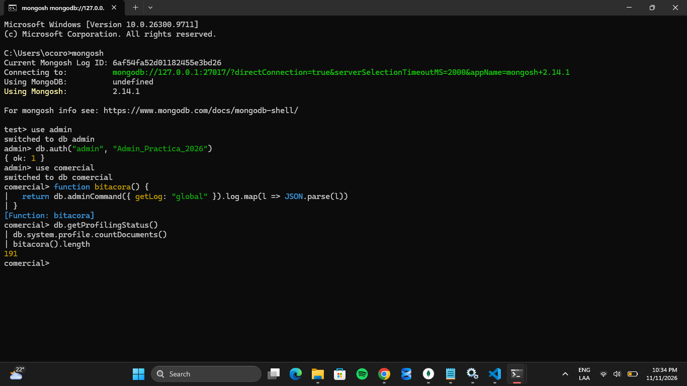

# 08 - Conservación: Exportar Antes de Perder

## Preguntas

### 1. Menciona tres formas en que la evidencia del perfilador o de la bitácora puede perderse sin que nadie la borre deliberadamente.
* **Reinicio del servicio `mongod`:** La configuración dinámica del perfilador (`db.setProfilingLevel`) no persiste tras un reinicio y regresa a `was: 0` (apagado), dejando de registrar eventos nuevos; simultáneamente, el búfer en memoria de `getLog` se vacía por completo.
* **Sobrescritura por límite de tamaño en `system.profile`:** Al tratarse de una colección encapsulada (*capped collection*) de tamaño fijo (1 MB por defecto), cuando se llena, MongoDB sobrescribe automáticamente los documentos más antiguos con los registros entrantes.
* **Reinicio sin `logAppend: true` o rotación de logs del sistema:** Si el archivo de bitácora está configurado sin `logAppend: true` (comportamiento por defecto), cada reinicio de `mongod` trunca y reemplaza el archivo previo; asimismo, las políticas de rotación de logs del sistema operativo eliminan archivos históricos si no se respaldan externamente.

### 2. ¿Por qué el tamaño de 1 MB de `system.profile` es un problema de conservación y no solo de espacio?
Porque `system.profile` es una *capped collection* que funciona como una cola circular FIFO: al alcanzar 1 MB no detiene el servicio ni lanza una advertencia de almacenamiento, sino que **destruye silenciosamente los registros más antiguos** para dar cabida a los nuevos. En una base de datos con actividad moderada o con el perfilador en nivel 2, ese límite puede llenarse en cuestión de minutos o segundos, provocando la pérdida irreversible de la evidencia de un incidente antes de que pueda ser exportada.

### 3. ¿Por qué `getLog` sirve para interpretar pero no para conservar?
Porque `db.adminCommand({ getLog: "global" })` consulta únicamente un **búfer circular en memoria RAM** con capacidad máxima para los últimos **1024 eventos** del servidor. Está diseñado para diagnóstico inmediato en tiempo real, no para almacenamiento persistente: todo evento anterior a los últimos 1024 se descarta automáticamente de la memoria, y cualquier reinicio o caída del proceso `mongod` borra por completo su contenido.

